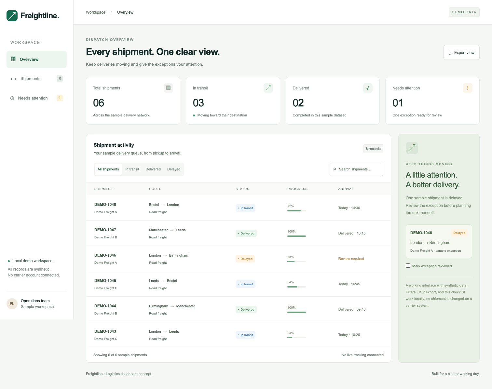

# Logistics Dashboard

A dispatch workspace built with Next.js and TypeScript. It shows a synthetic shipment queue, operational summaries, and searchable status filters. The dataset is deliberately local: this demo does not connect to a carrier, expose live locations, or claim real delivery metrics.

## Open the demo

```sh
npm install
npm run dev
```

Open `http://localhost:3000`. Use the search box to match a shipment ID, route, or carrier; select a status to narrow the table. An empty result includes a way to reset the filters.

## Design

`app/page.tsx` owns the typed sample records and filter state. The page uses semantic tables, explicit field labels, keyboard-accessible controls, visible focus styles, and a narrow-screen table scroller. `app/globals.css` defines the visual system with local system fonts, so the demo does not need remote font downloads.

`npm run build` checks the production bundle. This repository has no automated behavior suite yet. Before connecting a real API, add filter tests, request cancellation, server pagination, and tests for loading, empty, and failed requests. Real operational metrics need definitions and timestamps; the overview here is labeled as sample data.

## Preview



[Mobile layout](preview-mobile.png)

## Verification

Production build, TypeScript checking, and desktop/mobile Chrome checks passed. Browser checks cover status filters, search, empty-state reset, review state, CSV contents, and page overflow. The runtime is pinned to Next.js 15.5.29 and React 19.3.1; security overrides update PostCSS and Nano ID. Two moderate development-only minimatch advisories remain in lint tooling; no high or critical advisory matched the resolved lockfile at review time.
